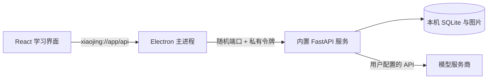

# 小鲸桌面客户端

桌面版把现有 React 界面、FastAPI 业务与 SQLite 资料库装进一个客户端。用户安装后不需要 Python、Node、终端或自建服务器；首次进入「模型连接」填写自己的 API 地址、密钥、模型名称即可。图片仍在日常提问、讲题、答题中使用。

## 当前选择

| 方案 | 对这个项目的实际影响 |
| --- | --- |
| Electron + 内置 Python 服务（当前） | 复用现有业务、统一 Chromium 渲染，支持桌面原生菜单和文件选择；安装包较大 |
| Tauri + Python sidecar | 桌面壳更小，但仍需携带 Python，各平台 WebView 行为需要额外验证；也不能直接把 Python sidecar 搬到 Android |
| 仅做网页快捷方式/PWA | 容易分发界面，但无法解决用户仍需另行启动 Python 服务的问题 |

第一阶段交付 Windows x64 和 macOS Intel / Apple Silicon 的独立构建。先保留现有数据库、算法和图片管理，避免为包装客户端而重写整套学习逻辑。

## 运行结构



- 界面固定使用 `xiaojing://app`，避免端口变化导致本地连接配置丢失。主进程转发普通请求、图片和 SSE 流；私有服务令牌不交给页面。
- Python 服务只监听 `127.0.0.1` 的随机空闲端口，所有路由要求进程随机生成的令牌。用户不需要开放端口。
- 沙箱渲染器关闭 Node 集成，启用上下文隔离与内容安全策略。预加载桥只暴露版本、打开资料库、备份、导入四个操作；原生操作校验调用窗口及来源。
- 外部 HTTP(S) 链接在系统浏览器打开；不允许加载外部页面为主界面或执行任意本地协议。模型返回内容仍通过现有 Markdown、图片和 Mermaid 安全处理。
- 客户端关闭时结束服务。父进程意外退出也会关闭标准输入管道，让后台退出；常规退出有超时兜底。
- 重新启动或导入快照时，把遗留的生成任务标为可重试；保留已经写入数据库的回复，避免长期停在「正在生成」。
- macOS 关闭最后一个窗口会保持应用运行，点击 Dock 可重新打开；菜单「退出」或 `Cmd+Q` 完整结束应用与服务。

## 安装与数据

Windows 构建输出 `Xiaojing-0.2.0-win-x64.exe` 安装器。macOS 分别输出对应架构的 `.dmg` 和 `.zip`。GitHub 的 [Desktop builds](https://github.com/dazzlingwuming/Exercise-Question-System/actions/workflows/desktop-build.yml) 工作流保存通过检查的安装包；进入一次成功运行的 Artifacts 下载，默认保留 14 天。构建不自动创建 Release。

当前属于未使用发布者证书的测试发行版：Windows 未签名，macOS 使用本地 ad-hoc 签名，没有配置 Apple Developer 身份和公证。正式对外分发前需要接入这些凭据；Apple Silicon 与 Intel 在各自的 macOS 运行器构建、启动验证，不能把 Windows 上的打包成功当作 Mac 验证完成。

| 系统 | 应用数据根目录 |
| --- | --- |
| Windows | `%APPDATA%\Xiaojing` |
| macOS | `~/Library/Application Support/Xiaojing` |

资料库位于其中的 `library` 或导入后创建的 `library-<UUID>`。`library-location.json` 指向正在使用的资料库，`logs/backend.log` 保存本地服务错误。桌面菜单「资料库」或「模型连接」页可直接打开目录、备份和导入。

安装文件和资料库分开，更新同一应用会保留数据，Windows 卸载器也不主动删除资料库。目前使用手动安装升级；自动更新尚未接入。

模型连接和 API Key 存在当前资料库对应的客户端本地存储中，目前没有接入操作系统密钥库加密。它们不写入聊天记录或资料库备份。切换/导入新资料库使用独立界面存储，避免旧资料库的草稿、题目编号和配图串入新资料库。

## 从网页版迁移

1. 结束正在生成的回复，保存学习内容。
2. 找到原项目实际使用的数据目录。默认是项目根目录的 `data`；如果配置过 `EXERCISE_DATA_DIR`，以配置的目录为准。
3. 在客户端选择「导入已有资料库」，选中**同时包含 `question_practice.sqlite3` 和 `media` 图片目录的文件夹**。没有图片的旧题库可以没有 `media`。
4. 确认题目、讨论和图片数量。客户端检查数据库与图片完整性，复制到新建的托管目录，成功启动后再切换；不会改动原文件夹，旧客户端资料库也会保留。
5. 在新资料库的「模型连接」重新填写 API 配置。

备份使用 SQLite 在线备份接口，包含已提交的题库、集合、练习、讨论历史以及托管图片。不把 `.env`、模型密钥、未发送草稿、主题偏好或整个浏览器缓存混入备份。备份是带 `xiaojing-backup.json` 的文件夹，可以自行压缩传输，恢复时选解压后的文件夹。复制过程中出错会保留原库；未完成的目标副本不会成为当前资料库。

## 从源码构建

开发机需要 Node 22.12+ 和 Python 3.12。使用独立 Python 虚拟环境安装依赖，建议使用 python.org 或 CI 提供的标准解释器。Windows PowerShell 示例：

```powershell
python -m venv desktop/.venv
desktop/.venv/Scripts/python.exe -m pip install -r desktop/requirements-build.txt
npm ci --prefix frontend
npm ci --prefix desktop
npm --prefix desktop run prepare:ui
desktop/.venv/Scripts/python.exe desktop/scripts/build-backend.py
node desktop/scripts/smoke-backend.cjs
npm --prefix desktop start
```

macOS 使用 `desktop/.venv/bin/python` 代替 `Scripts/python.exe`。构建后端、Electron 和安装包的架构必须一致。构建脚本只携带程序和仓库中那一份示例题库 Markdown，不会携带开发者数据库、上传图片或 `.env`。

```powershell
npm --prefix desktop test
npm --prefix desktop run pack
node desktop/scripts/smoke-packaged.cjs
npm --prefix desktop run dist
```

产物在 `desktop/release/`；`pack` 输出可直接启动的应用目录，`dist` 输出安装器。本地启动调试 UI 也要先重新执行 `prepare:ui`。原网页版的开发、构建和部署方式保持可用。

## 验证范围

- Python 测试验证在线数据库快照、缺图拒绝、目标覆盖保护及服务令牌校验。
- Node 测试验证静态路径边界、外链限制、CSP、私有令牌转发和流式返回。
- `smoke-backend.cjs` 清除开发环境 Python/Conda PATH 后启动内置服务，检查免 Python 运行、访问保护和退出。
- `smoke.cjs` 通过 Playwright 的 Electron API 启动真实客户端，用独立测试资料库和本地模拟模型验证设置连接、图片上传、图片对话、公式与流程图、停止、重启持久化、备份/导入。不会使用真实模型密钥或产生 API 费用。
- CI 在 Windows、Mac Intel、Mac ARM 上先运行回归测试，再构建应用，检查打包后的应用，通过后才上传安装包。测试截图位于 `output/playwright/desktop-*.png`。

## Android 的后续路线

Android 放在桌面体验稳定之后。React 页面和模型接口配置可以复用；当前 Python 服务和桌面文件路径不能原封不动放到手机上。

下一阶段建议先抽出「模型调用、资料存取、媒体管理」三个平台接口，再用 Capacitor 包装移动端界面：

1. **先做日常对话与图片**：相机/相册、裁剪压缩、流式回复、取消重试、Android 返回键与键盘适配。使用原生 HTTP 通道调用用户配置的模型，避免 WebView 跨域限制；密钥使用 Android Keystore 支持的存储。
2. **再做本地学习记录**：SQLite 存题库与消息、应用私有目录存图片。把题库筛选、练习状态迁移为可验证的平台实现，并通过同一组规则样例对齐桌面行为。不能只展示页面而丢掉离线数据。
3. **最后做多端同步**：先支持可校验的备份导入导出，再决定是否建设有身份认证的同步服务，处理图片去重、版本冲突与删除记录。手机应可以独立使用，不依赖电脑一直开机。

不会在第一轮同时加入 Android、3D 建模、图片生成服务和云账户体系。优先把「连接自己的 API → 随手提问/贴图 → 保存与复习」这条链路做好，再按实际使用反馈扩展。

## 官方依据

- [Electron Protocol API](https://www.electronjs.org/docs/latest/api/protocol)：标准安全协议、自定义响应与流式处理。
- [Electron 安全建议](https://www.electronjs.org/docs/latest/tutorial/security)：沙箱、上下文隔离、来源与导航校验。
- [PyInstaller 文档](https://www.pyinstaller.org/en/stable/)：打包 Python 依赖，需要在目标操作系统构建。
- [GitHub 托管运行器](https://docs.github.com/en/actions/reference/runners/github-hosted-runners)：Windows、Mac Intel 与 ARM 原生构建环境。
- [Playwright Electron API](https://playwright.dev/docs/api/class-electron)：原生客户端启动和文件对话框替身测试。
- [electron-builder v26 的 Mac 签名说明](https://www.electron.build/v26/docs/features/code-signing/code-signing-mac/)：无发布证书时的 ad-hoc 签名及所需权限。
- [Capacitor](https://capacitorjs.com/docs)：未来移动端接入原生能力的候选方案，当前未生成 Android 安装包。
